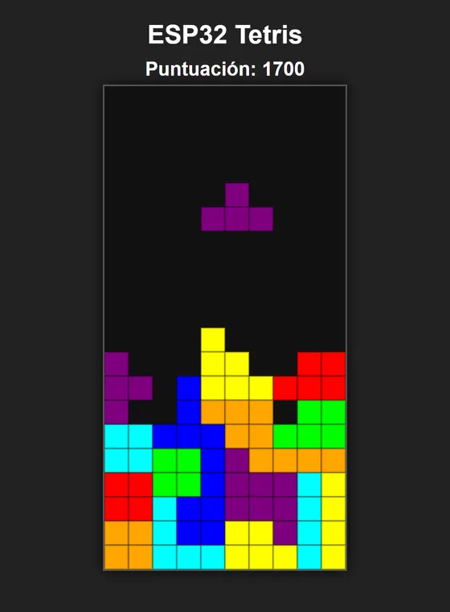
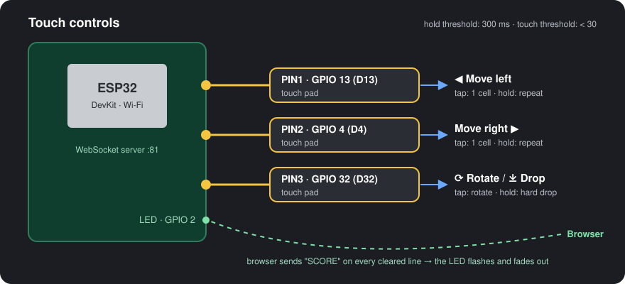

<div align="center">

# ESP32 Tetris

**A falling-blocks game in the browser, played with the capacitive touch pins of an ESP32.**

*Touch a wire to move, rotate and drop the pieces. Every time you clear a line, the ESP32's LED flashes.*

[](https://www.espressif.com)
[](https://platformio.org)
[](https://isocpp.org)
[](https://developer.mozilla.org/docs/Web/API/Canvas_API)
[](https://developer.mozilla.org/docs/Web/API/WebSockets_API)

<br>



</div>

---

## What is it?

A project for the **Internet of Things** course: a classic falling-blocks game whose controller is an
**ESP32**. Three GPIOs are used as **capacitive touch sensors**; the board reads them, detects taps and
long presses, and sends the events over **WebSockets** to a web page that runs the game on an HTML
canvas. The communication goes both ways: when a line is cleared, the page tells the ESP32 and its
built-in LED lights up and fades out.

No buttons or extra components are needed: a jumper wire (or a piece of aluminum foil) on each touch
pin is enough.

---

## 🎮 Controls

<div align="center">



</div>

### With the ESP32

| Touch pin | Tap | Hold (≥ 300 ms) |
| :--- | :--- | :--- |
| **PIN1 · GPIO 13 (D13)** | Move one cell left | Keep moving left (every 100 ms) until released |
| **PIN2 · GPIO 4 (D4)** | Move one cell right | Keep moving right (every 100 ms) until released |
| **PIN3 · GPIO 32 (D32)** | Rotate the piece 90° | **Hard drop** (the piece falls to the bottom at once) |

### With the keyboard (for testing without the board)

| Key | Action |
| :---: | :--- |
| <kbd>←</kbd> | Move left |
| <kbd>→</kbd> | Move right |
| <kbd>↑</kbd> | Rotate |
| <kbd>Space</kbd> | Hard drop |

---

## ✨ Features

- 🧱 **Classic gameplay** on a 10 × 20 board with the seven tetrominoes, each with its own color.
- ⬇️ **Gravity** of one row per second, collision checks against walls, floor and placed blocks.
- 🔄 **Rotation** that is rejected if the piece would go through a wall or another block.
- 🧹 **Line clearing** with classic scoring: 100, 300, 500 and 800 points for 1, 2, 3 or 4 lines.
- 🔁 **Game over** resets the board and the score automatically.
- ✋ **Touch events** from the ESP32: `TOUCH`, `HOLD` and `RELEASE` per pin, so a quick tap and a long
  press do different things.
- 💡 **Feedback on the hardware**: the browser sends `SCORE` on every cleared line and the LED on
  GPIO 2 fades out with PWM.

---

## ⚙️ How it works

```
 ┌──────────── ESP32 ────────────┐          WebSocket :81          ┌──────── Browser ────────┐
 │ touchRead(13 / 4 / 32)        │  ── PIN1_TOUCH / _HOLD / ... ─▶ │ app.js                   │
 │  · value < 30  → touched      │                                 │  · moves / rotates /     │
 │  · held 300 ms → HOLD         │                                 │    drops the piece       │
 │ LED GPIO 2 (PWM fade)         │  ◀────────── "SCORE" ────────── │  · clears lines, scores  │
 └───────────────────────────────┘                                 └──────────────────────────┘
```

The firmware polls the three pads every 10 ms and broadcasts a message only when the state changes,
so the page receives clean events instead of raw readings.

---

## 🏗️ Project Structure

```
proyectoTetris/
├── ProyectoESP32/           # PlatformIO project (firmware)
│   ├── platformio.ini       # esp32dev, Arduino framework, WebSockets + ArduinoJson
│   └── src/main.cpp         # Wi-Fi, WebSocket server, touch reading, LED effect
└── tetris/                  # Web game
    ├── index.html           # Canvas and score
    └── app.js               # WebSocket client, game logic and rendering
```

---

## 🚀 Getting Started

### What you need
- An ESP32 DevKit (`esp32dev`)
- Three jumper wires on GPIO 13, GPIO 4 and GPIO 32
- [PlatformIO](https://platformio.org) (VS Code extension or CLI)
- A computer on the **same Wi-Fi network** as the ESP32

### 1. Flash the ESP32

Set your network in `ProyectoESP32/src/main.cpp`:

```cpp
const char* ssid = "YOUR_NETWORK";
const char* password = "YOUR_PASSWORD";
```

Then build, upload and open the serial monitor:

```bash
cd ProyectoESP32
pio run --target upload
pio device monitor        # 115200 baud, prints the ESP32's IP
```

### 2. Open the game

Put the IP printed by the serial monitor in `tetris/app.js`:

```js
const ESP32_IP = '192.168.x.x';
```

Open `tetris/index.html` in the browser. The console shows *"¡Enlazado con la ESP32!"* when the
connection is ready. Without the board, the game still works with the keyboard.

> If the pads react on their own or not at all, adjust `TOUCH_LIMIT` (default `30`) in `main.cpp`:
> the right value depends on the wire length and the board.

---

<div align="center">
  Created by <b>Juan Carlos Orozco Nieto</b> · IoT course project
</div>
